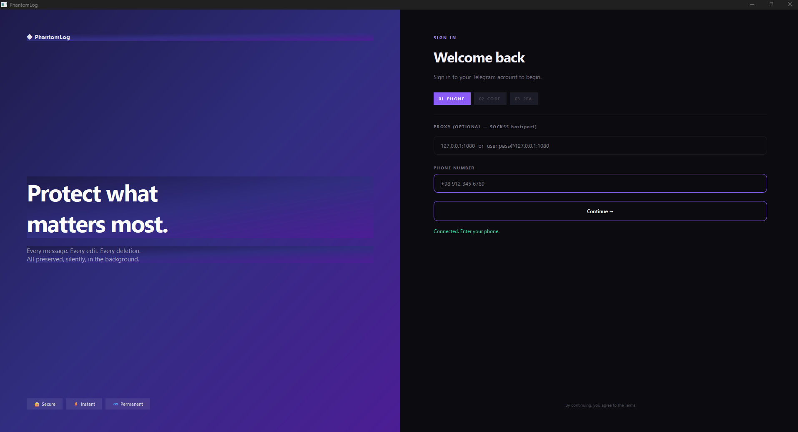
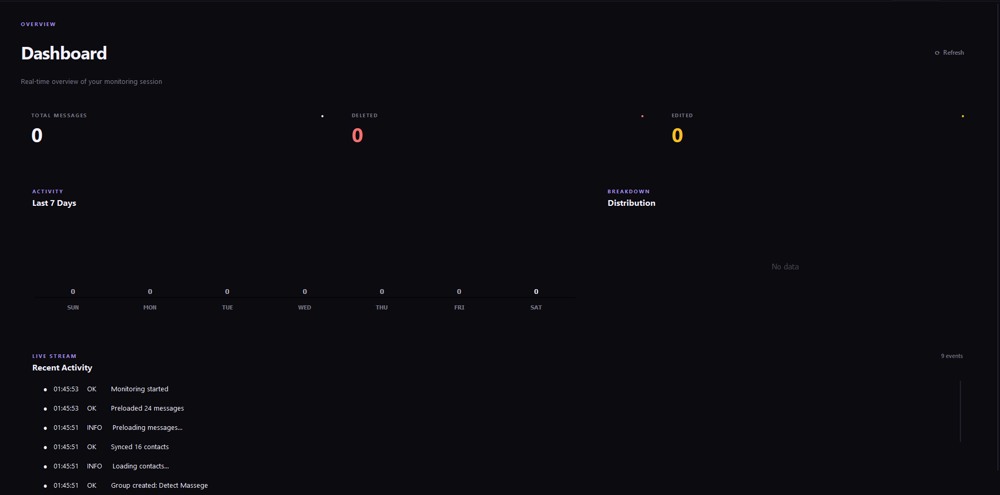

# PhantomLog

> The Silent Guardian for Your Messages

A powerful desktop companion for Telegram that keeps a watchful eye on your conversations — recording what disappears, tracking who changes, and letting you reach anyone from one place.

Made by **itslosti** · **PhontomLab**

---

## 📸 Screenshots

### The Main Interface

### Built-in Messenger

---

## ✨ What It Does

Telegram is built for ephemeral moments — messages get deleted, profiles change, friends come online and go dark, all in the blink of an eye. **PhantomLog is the memory that Telegram doesn't give you.**

It runs quietly in the background, observing your private conversations, and preserves what would otherwise vanish forever.

### 🚨 Deleted Message Recovery
Every message that someone deletes from a private chat is captured and instantly forwarded to a private archive group on your own account — complete with sender name, username, user ID, timestamp, and any attached media. You will *always* know what was said, even after it's gone.

### 👤 Contact Surveillance
Silently tracks your contacts and records:
- Online / offline transitions (with last-seen timestamps)
- Name and last-name changes
- Username changes
- Profile photo updates
- Bio changes

Every change is logged in a timeline you can revisit at any time.

### 💬 Built-in Messenger
A full messaging interface right inside the app — no need to switch to Telegram. Send and receive messages, browse your chat list, open conversations, and reach anyone by username, phone number, user ID, or `t.me` link.

### 🔑 Keyword Alerts
Set custom keywords (e.g. `urgent`, `meeting`, `address`). Whenever a message containing those words arrives, you get an instant desktop notification.

### 📜 Complete Message Archive
A searchable, filterable history of every message that has passed through your account:
- Filter by **All / Active / Deleted / Edited**
- Full-text search across messages and sender names
- Visual markers for edited and deleted entries

### 📊 Real-Time Dashboard
A live overview of your account's activity:
- Total messages monitored
- Deleted messages count
- Edited messages count
- 7-day activity chart
- Distribution breakdown
- Live event stream

### 🔔 Desktop Notifications
Get notified the moment something happens — a message deleted, a contact comes online, a keyword is triggered, a profile changes.

### 📤 Data Export
Export your entire monitoring history as **CSV** or **JSON** — for backups, analysis, or archival.

### 🔒 Auto-Join Guardian
The app automatically ensures your membership in the official channel stays active. If you ever leave, it quietly rejoins within seconds — completely in the background, without blocking your workflow.

---

## 🚀 Getting Started

### Installation

1. Run **`PhantomLog_Setup.exe`**
2. Follow the installation wizard
3. Launch **PhantomLog** from your desktop or Start Menu

That's it. No technical setup required.

### First Sign-In

1. Enter your **phone number** (with country code, e.g. `+98 912 345 6789`)
2. You'll receive a **verification code** from Telegram — enter it
3. If you have **Two-Factor Authentication** enabled, enter your password
4. You're in ✨

Your session is remembered — you won't need to sign in again unless you explicitly log out.

### Using a Proxy (Optional)

If Telegram is blocked or slow in your region, you can route traffic through a SOCKS5 proxy:

- Format: `host:port` — example: `127.0.0.1:1080`
- With authentication: `user:pass@host:port`

Enter the proxy in the sign-in screen before connecting.

---

## 🧭 Navigating the App

The app is organized into seven tabs at the top:

### **Dashboard**
Your live control room. See total messages, deletions, edits, a 7-day chart, and a real-time stream of every event as it happens.

### **Messages**
The built-in messenger.
- **Search** chats from the sidebar
- **Click** any chat to open it
- **Type** in the input box and hit **Enter** (or click **Send**)
- Click **`+ New`** to start a conversation with any username, phone number, user ID, or `t.me` link
- Media messages are labeled with clear icons (🖼 Photo, 🎥 Video, 🎤 Voice, 📎 File, 🎨 Sticker)

### **Contacts**
A live list of everyone in your Telegram contacts.
- 🟢 **Green dot** — currently online
- 🟡 **Yellow dot** — recently active
- ⚪ **Gray dot** — offline
- ⭐ **Star** — marked as watched (watchlist)

**Double-click** any contact to open their profile — see their info, watch them, view their activity timeline, or **send them a message** directly from within the app.

Click the **`⭐ Watched`** chip to filter only the contacts you care about.

### **History**
Your complete message archive.
- Use the **search bar** to find anything
- Use the **chips** to filter by All / Active / Deleted / Edited
- Deleted messages are marked with **×**
- Edited messages are marked with **✎**

### **Alerts**
Customize your notification preferences:
- Toggle **desktop notifications** on or off
- Set **comma-separated keywords** for automatic alerts

### **Logs**
A raw system log — useful for understanding exactly what the app is doing at every moment. Every action, event, and background process is timestamped here.

### **Settings**
- **Max Media Size** — cap the size of media files that get downloaded (in MB)
- **Export Data** — save your entire history as CSV or JSON
- **Mandatory Channel** — see the required channel info

---

## 🎨 Key Behaviors

| Action | What Happens |
|---|---|
| Someone deletes a message | It's captured, forwarded to your archive group, and logged |
| Someone edits a message | The edit is flagged in your history |
| Someone changes their profile | The change is logged in their timeline |
| A contact goes online | You get a notification (if you're watching them) |
| A keyword appears in a message | You get an instant notification |
| You leave the required channel | The app silently rejoins in the background |
| You close the window | The app keeps running in the system tray |
| You log out | Your session is cleared from the device |

---

## 💡 Tips

- **Watch only who matters.** With hundreds of contacts, starring the ones you care about reduces notification noise.
- **Use keywords wisely.** Pick words you'd never say casually — they'll only notify you when they truly matter.
- **Check the Logs tab** if something seems off. Every action is recorded there.
- **Export regularly.** Keep a local backup of your history in case you ever want to analyze it externally.
- **The tray icon is your friend.** Right-click it to restore the window or quit the app.
- **Media is downloaded only for messages received while the app is running.** Older messages are recorded as text-only.

---

## 🔐 Privacy

- Your Telegram session stays on your device
- Nothing is sent to any server except Telegram itself
- All message history, contact data, and media are stored locally
- The archive group is created on *your own* account — you are the only person who can see it

---

## 🛟 Troubleshooting

**"Connecting…" takes too long**
Telegram may be unreachable in your region. Try a proxy (see above).

**Messages aren't being forwarded**
Make sure the archive group exists. Open the **Messages** tab — you should see a group called "Detect Massege" — if you accidentally deleted it, restart the app and a new one will be created.

**Notifications aren't showing**
Check that they're enabled in **Alerts**, and that Windows allows notifications from PhantomLog (Settings → System → Notifications).

**I need to change accounts**
Click **Logout** in the top-right corner, then sign in with the new phone number.

---

## 💬 Feedback

Found a bug? Have an idea? Reach out through the channel:

**@PhontomClient**

---

## 👤 Credits

**Developer:** itslosti
**Studio:** PhontomLab

---

*PhantomLog — because nothing on the internet should ever truly disappear.*
