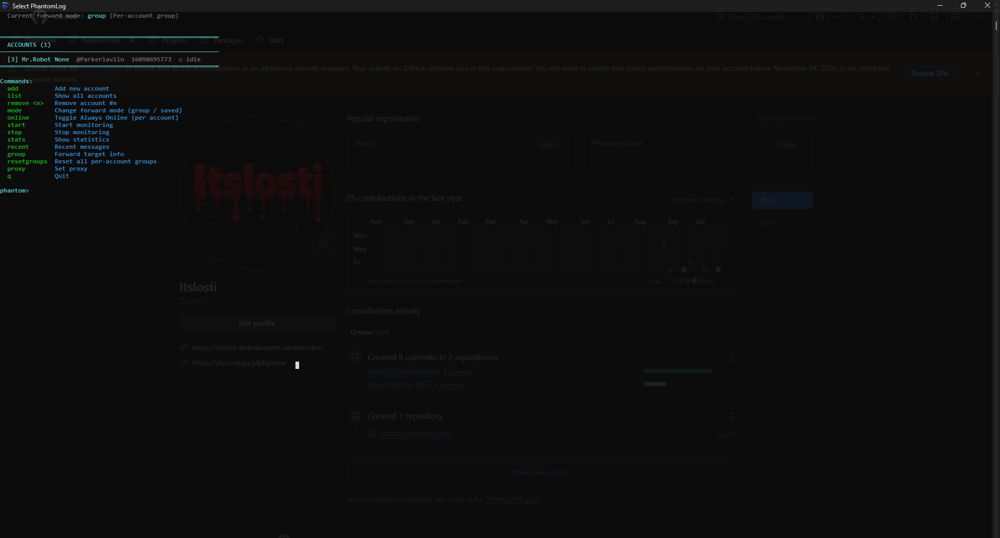

# PhantomLog

> The Silent Guardian for Your Messages

A powerful, multi-account console application built for Telegram. It runs silently in the background, monitoring your conversations, capturing deleted messages, tracking contact activity, and keeping your accounts online — all from a single, secure terminal interface.

Made by **itslosti** · **PhontomLab**

---

## ✨ What It Does

Telegram is built for ephemeral moments. Messages get deleted, profiles change, and friends go offline — often before you even notice. **PhantomLog is the memory that Telegram doesn't give you.** 

It operates purely in a command-line environment, making it lightweight, extremely fast, and completely independent of a graphical interface.

### 🚨 Deleted Message Recovery
Every message that someone deletes from a private chat is captured and instantly forwarded to a secure destination of your choice — complete with sender name, username, user ID, timestamp, and any attached media. You will *always* know what was said, even after it's gone.

### 👤 Contact Surveillance
Silently tracks your contacts and records:
- Online / offline transitions (with last-seen timestamps)
- Name and last-name changes
- Username changes
- Profile photo updates
- Bio changes

Every change is logged in a timeline you can revisit at any time.

### 🟢 Always Online Mode
Keep your accounts showing as "Online" 24/7 to everyone — even when the app isn't running and your phone is offline. This feature can be toggled independently for each account.

### 👥 Multi-Account Support
Add unlimited Telegram accounts. Each account operates entirely independently, with its own session, its own data, and its own monitoring rules.

### 🔑 Keyword Alerts
Set custom keywords (e.g. `urgent`, `meeting`, `address`). Whenever a message containing those words arrives, you get an instant alert in the console.

### 📜 Complete Message Archive
A searchable, filterable history of every message that has passed through your account:
- Filter by **All / Active / Deleted / Edited**
- Full-text search across messages and sender names
- Visual markers for edited and deleted entries

### 📤 Data Export
Export your entire monitoring history as **CSV** or **JSON** — for backups, analysis, or archival.

---

## 🚀 Getting Started

### Installation

1. Run **`PhantomLog_Setup_4.5.exe`**
2. Follow the installation wizard
3. Launch **PhantomLog** from your desktop or Start Menu
4. A terminal window will open. Type `help` to see all available commands.

### First Sign-In

When you type `add` to add your first account, you will be prompted to sign in:

1. Enter your **phone number** (with country code, e.g. `+98 912 345 6789`)
2. You'll receive a **verification code** from Telegram — enter it
3. If you have **Two-Factor Authentication** enabled, enter your password
4. You're in ✨

Your session is remembered — you won't need to sign in again unless you explicitly remove the account.

### Using a Proxy (Optional)

If Telegram is blocked or slow in your region, you can route traffic through a SOCKS5 proxy before adding an account:
